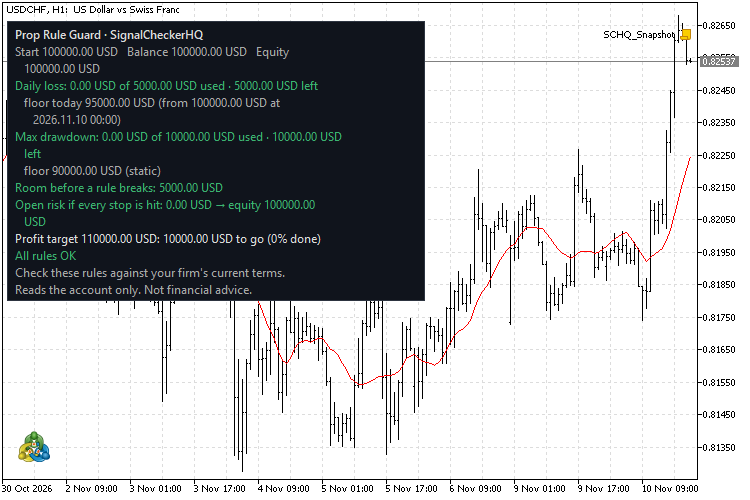
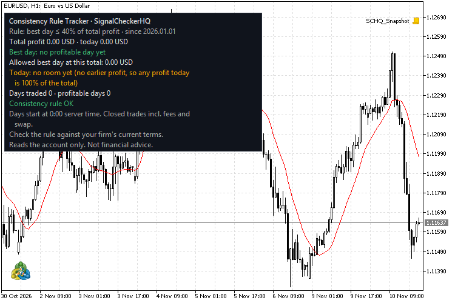

# Prop firm tools (NinjaTrader 8 + MetaTrader 5)

Two free, open-source indicators for prop-firm accounts. Both put the rule math on the chart. Both **only read the account**: they never place, change or close orders.

| Indicator | What it shows | NinjaTrader 8 | MetaTrader 5 |
|---|---|---|---|
| **Prop Rule Guard** | Room left before the daily loss limit and the max drawdown, open risk if every stop is hit, profit target left | `ninjatrader8/SCHQPropRuleGuard.cs` | `mt5/SCHQ_PropRuleGuard.mq5` |
| **Consistency Rule Tracker** | Best day as % of total profit (or of the target), how much more today can make within the rule, profit still needed if it is broken | `ninjatrader8/SCHQConsistencyTracker.cs` | `mt5/SCHQ_ConsistencyTracker.mq5` |

**New here? Read [How to use](HOW_TO_USE.md)** (5-minute setup and how to read the panel).

## Install

**NinjaTrader 8:** download [`ninjatrader8/SCHQ_PropTools_NT8.zip`](ninjatrader8/SCHQ_PropTools_NT8.zip), then in NinjaTrader: Tools > Import > NinjaScript Add-On, pick the zip. Both indicators appear under Indicators. The zip holds the source code (no compiled DLL).

**MetaTrader 5:** copy the `.mq5` files into `MQL5\Indicators` (File > Open Data Folder in MT5), open them in MetaEditor and press F7 to compile. They are also submitted to the MQL5 Code Base.

## Prop Rule Guard

- Daily loss floor = balance at the start of the trading day minus the daily limit (option: the higher of balance and equity at the start of the day).
- Max drawdown floor: static (start balance minus the limit), intraday trailing or end-of-day trailing; a trailing floor can stop at the starting balance.
- The panel uses the tighter floor, checks every open position against its working stop (positions without a stop are flagged), and shows the profit target and (NinjaTrader) contracts open vs your max.
- Warnings at a set % of a limit and on a breach.
- NinjaTrader: leave Account name empty and the indicator finds your trading account (Sim101 last).

## Consistency Rule Tracker

- Closed results (profit, swap, commission and fees) are grouped by trading day.
- Best day = the biggest single-day profit. The rule holds while best day <= X% of total profit (or X% of the target).
- Today's cap = X% x (earlier days' total) / (1 - X%). Example: earlier days +1,000, rule 40%, today's cap 666.67.
- If the rule is already broken: total profit still needed = best day / X% - total profit.
- Profitable days vs a required number, with an optional minimum per day.
- MT5 reads the deal history; NinjaTrader records each day's realized P&L (Documents\NinjaTrader 8\SCHQ) and takes earlier days you type in.

## Limits

Firms word these rules differently (which balance the day starts from, when the day resets, whether open profit counts, whether the consistency rule applies to the challenge or only to payouts). Set the inputs to your firm's current terms. Tested on a NinjaTrader demo account (MES) and a MetaQuotes demo account (MT5 build 6314). Not financial advice.

Bug reports and questions: open an issue.

## License

[Mozilla Public License 2.0](LICENSE). By SignalCheckerHQ.
